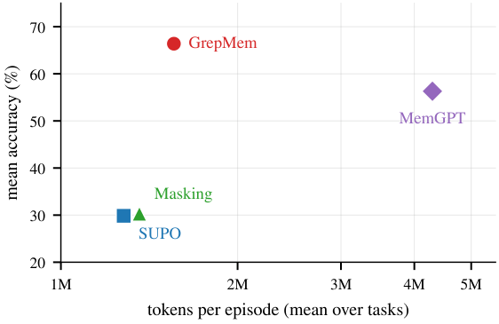

# GrepMem

### Forget Freely, Grep Later: Lossless, Index-Free Memory for Long-Horizon LLM Agents

**Ziyan Yang\*, Taiwei Shi\*, and Jieyu Zhao**

University of Southern California · \*Equal contribution

[Quick start](#quick-start) · [Reproduction](docs/reproduction.md) · [Method and configuration](docs/method.md) · [License](LICENSE)

**Summarize the context. Keep the history. Grep what you need.**

GrepMem lets an agent compact its working context without deleting its interaction history.
An append-only log retains the original messages and tool outputs; after compaction,
the agent can retrieve details with `grep_history`. Reinforcement learning trains the
same policy to research, summarize, and recall.

No embedding model, vector database, or learned index is needed **for the agent's memory**.
Research tasks still use a separate document-retrieval server.
“Lossless” describes the stored history, not a guarantee that the agent retrieves every relevant fact.



## Results at a glance

Accuracy (%) of the **RL-trained models**, all based on [Qwen3.5-9B](https://huggingface.co/Qwen/Qwen3.5-9B):

| Strategy | BCP-Multi | AMA file | AMA stream | ContextBench KV | ContextBench Log | Average |
|---|---:|---:|---:|---:|---:|---:|
| ReAct | 0.2 | 38.3 | 26.6 | 0.0 | 0.0 | 13.0 |
| SUPO | 38.1 | 45.5 | 45.2 | 13.9 | 6.6 | 29.8 |
| Masking | 34.8 | 44.5 | 44.9 | 20.7 | 6.6 | 30.3 |
| MemGPT | 39.9 | **46.4** | 45.4 | **99.9** | 50.0 | 56.3 |
| **GrepMem** | **46.9** | 46.3 | **46.1** | 97.4 | **95.3** | **66.4** |

GrepMem's clearest gains are on multi-question research sessions and exact recall from long streams.
The small AMA-Bench differences are uncertain; GrepMem does not improve every task equally.
These are the paper's reported results, not measurements from the quick start below.
All after-RL results use the checkpoint selected after 80 updates, after inspecting evaluation curves.
The average gives equal weight to the five task columns.

**Release status:** code and reproduction instructions are included. Public paper and trained-checkpoint
links are not yet available. The quick start uses the base model, not the RL-trained weights.

## Quick start

### 1. Install the evaluation client

Use a fresh Python environment (Python 3.10+; Python 3.12 is recommended for the GPU stack).
The client and fake-model tests do not need GPUs.

```bash
git clone https://github.com/limenlp/GrepMem.git
cd GrepMem
python3 -m venv .venv
source .venv/bin/activate
python -m pip install -r requirements-dev.txt
python -m pip install --no-deps \
  "rllm @ git+https://github.com/rllm-org/rllm.git@4e828c81680e5a85b638ceedeaf09d1e90109ca8"
python -m pytest
```

The pinned rLLM core supplies the flow, task, and dataset interfaces.
`--no-deps` is intentional **for evaluation only**: `requirements.txt` contains the client dependencies,
without rLLM's training backends. For training, use the [full installation](docs/reproduction.md#training).

### 2. Start a model server

On a separate GPU terminal, install the serving stack and launch the base model:

```bash
python -m pip install "vllm==0.22.1"
GPUS=0 bash scripts/serve.sh Qwen/Qwen3.5-9B
```

This runs in the foreground and binds to localhost. Check `http://localhost:8000/health` before
starting evaluation. For another machine, configure the bind address and client URL on a trusted network.
The serving configuration targets H100-class GPUs; smaller GPUs may need a different parallelism setup.

### 3. Run a small exact-recall evaluation

ContextBench generates its inputs locally and uses a programmatic grader, so this example
needs neither a judge API nor a document-retrieval server:

```bash
python cb_eval.py --agent summary_grep \
  --base-url http://localhost:8000/v1 \
  --levels "kv_store:R1000 log_triage:L1600" --seeds 42 \
  --concurrency 2 --out outputs/quickstart/contextbench.jsonl
```

Outputs contain per-instance results and an aggregate `.summary.json`.
Run the same command again to resume an interrupted evaluation.
This small base-model example is not the full paper evaluation.

## Reproduce the experiments

See [the reproduction guide](docs/reproduction.md) for data downloads, judge configuration,
document retrieval, GRPO training, saved checkpoints, and the full evaluation commands.

| Paper strategy | `--agent` / `AGENT` | Implementation |
|---|---|---|
| [ReAct](https://openreview.net/forum?id=WE_vluYUL-X) | `react` | Keep the context; stop when it fills |
| [SUPO](https://aclanthology.org/2026.acl-long.966/) | `summary` | The policy writes and learns its own summaries |
| [Observation masking](https://arxiv.org/abs/2508.21433) | `mask` | Replace old observations with placeholders |
| [MemGPT](https://arxiv.org/abs/2310.08560) | `memgpt` | Working memory, archival retrieval, and conversation search |
| GrepMem | `summary_grep` | Policy-generated summaries plus full-history grep |

These implementations share one agent loop and interaction budgets. Our MemGPT baseline uses
**BM25 archival search and substring conversation search**, not embeddings.

We evaluate two question timings. In **BCP-Multi** (our random triples of
[BrowseComp-Plus](https://huggingface.co/datasets/Tevatron/browsecomp-plus) questions) and
[AMA-Bench](https://github.com/AMA-bench/AMA-bench)'s **file protocol**, questions are known upfront.
In **AMA stream** and [ContextBench](https://github.com/RulinShao/ContextBench), questions
arrive after the input. In AMA file, every strategy can search the supplied trajectory with
`grep_trajectory`; only GrepMem additionally searches its own interaction history with `grep_history`.

## Repository layout

```text
agents/                 Shared agent loop, memory strategies, tools, and rewards
retrieval/server.py     Document search for research tasks (separate from memory)
data/prepare_data.py    Dataset preparation and deterministic training mixture
train.py                rLLM / verl training entry point
eval.py                 BCP-Multi research evaluation
cb_eval.py              ContextBench evaluation
ama_eval.py             AMA-Bench file and stream evaluation
scripts/                Download, serving, training, and evaluation commands
patches/                Pinned rLLM gateway compatibility patch
tests/                  CPU tests with synthetic inputs and fake model replies
docs/                   Reproduction protocol and method/configuration reference
```

## Development and attribution

```bash
python -m pytest
ruff check .
ruff format --check .
```

Built on [rLLM](https://github.com/rllm-org/rllm), [verl](https://github.com/verl-project/verl),
[vLLM](https://github.com/vllm-project/vllm), and
[OpenResearcher](https://huggingface.co/datasets/OpenResearcher/OpenResearcher-Dataset).
Our code is MIT-licensed; adapted third-party code retains its original license
([attributions](NOTICE.md)). Models and datasets have their own terms.
Do not commit downloaded benchmark questions, reference answers, credentials, or generated trajectories.

For attribution before the paper link is available, use the title and author list above.
An official citation will be added with the public paper.
